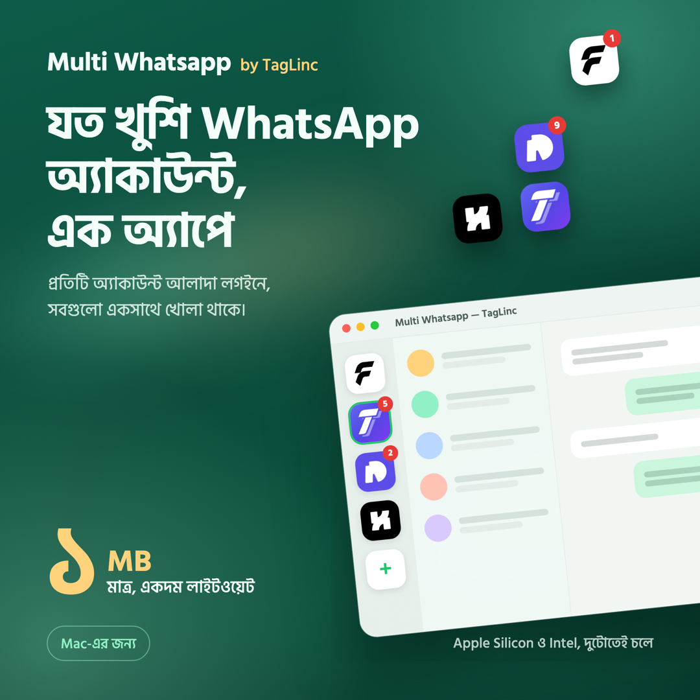

# Whatsapp by TagLinc



যত খুশি WhatsApp অ্যাকাউন্ট, এক অ্যাপে। Mac ও Windows-এর জন্য ছোট্ট একটি অ্যাপ।

Run as many WhatsApp accounts as you like in one small app for Mac and Windows.

## ডাউনলোড / Download

| | |
|---|---|
| **Mac** | **[Whatsapp-by-TagLinc.dmg ডাউনলোড করুন](https://github.com/mhmehedi/whatsapp-by-taglinc/releases/latest/download/Whatsapp-by-TagLinc.dmg)**<br>macOS 14 (Sonoma) বা নতুন · Apple Silicon ও Intel |
| **Windows** | **[Whatsapp-by-TagLinc-Setup.exe ডাউনলোড করুন](https://github.com/mhmehedi/whatsapp-by-taglinc/releases/latest/download/Whatsapp-by-TagLinc-Setup.exe)**<br>Windows 10 বা 11 (64-bit) |

সব ভার্সন: [Releases](https://github.com/mhmehedi/whatsapp-by-taglinc/releases)

## ইনস্টল: Mac / Install on Mac

1. DMG খুলে **Whatsapp by TagLinc** কে **Applications** ফোল্ডারে টেনে আনুন।
2. Applications থেকে অ্যাপটি খুলুন। macOS বলবে অ্যাপটি খোলা যাচ্ছে না, কারণ এটি App Store থেকে নয়। **Done** চাপুন।
3. **System Settings → Privacy & Security**-এ যান। নিচে "Whatsapp by TagLinc was blocked"-এর পাশে **Open Anyway** চাপুন, তারপর Mac-এর পাসওয়ার্ড বা Touch ID দিন। এটা একবারই করতে হবে।

   অথবা Terminal-এ চালান:
   ```bash
   xattr -dr com.apple.quarantine "/Applications/Whatsapp by TagLinc.app"
   ```
4. ফোনের WhatsApp থেকে QR কোড স্ক্যান করুন (**Settings → Linked devices → Link a device**)।

## ইনস্টল: Windows / Install on Windows

1. `Whatsapp-by-TagLinc-Setup.exe` চালান।
2. Windows যদি বলে **"Windows protected your PC"**, তাহলে **More info → Run anyway** চাপুন। অ্যাপটি কোনো পেইড সার্টিফিকেট দিয়ে সাইন করা নয়, তাই এটা দেখায়।
3. Install চাপুন। অ্যাডমিন পাসওয়ার্ড লাগে না। Start menu-তে **Whatsapp by TagLinc** পাবেন।
4. ফোনের WhatsApp থেকে QR কোড স্ক্যান করুন।

Windows-এ অ্যাপটি Microsoft Edge WebView2 ব্যবহার করে, যা Windows 10/11-এ আগে থেকেই থাকে। না থাকলে অ্যাপ ডাউনলোড লিংক দেখাবে।

## ব্যবহার / Using it

| | |
|---|---|
| **+** বা **⌘N** (Windows: Ctrl+N) | নতুন WhatsApp অ্যাকাউন্ট যোগ করুন |
| **⌘1 … ⌘9** (Windows: Ctrl+1 … 9) | অ্যাকাউন্ট বদলান |
| অ্যাকাউন্টে **right-click** | নাম বদলান বা অ্যাকাউন্ট সরান |
| **⌘R** | বর্তমান অ্যাকাউন্ট রিলোড |
| চ্যাট লিস্টের ডান কিনারা টানুন | চ্যাট লিস্ট ছোট-বড় করুন (ডাবল-ক্লিকে আগের মতো) |
| **Account → Sleep When Not Used** | ১৫ মিনিট ব্যবহার না করলে অ্যাকাউন্টটি বন্ধ হয়ে যায়, RAM খরচ হয় না (ঘুমন্ত অবস্থায় নোটিফিকেশন আসে না) |

- প্রতিটি অ্যাকাউন্ট আলাদা লগইনে থাকে, একটার ডেটা আরেকটার সাথে মেশে না।
- সব অ্যাকাউন্ট একসাথে খোলা থাকে; নতুন মেসেজ এলে ব্যাজ আর নোটিফিকেশন দেখায়।
- (শুধু Mac) কোনো অ্যাকাউন্ট চলতে চলতে অনেক বেশি RAM নিয়ে ফেললে (৭০০ MB-এর বেশি, আর খোলার সময়ের চেয়ে ৪০০ MB বেশি), আপনি সেটা না দেখার সময় অ্যাপ নিজেই সেটা রিলোড করে। লগআউট হয় না।
- একবারে অ্যাপের একটাই কপি চালান। দুটো কপি একসাথে চললে WhatsApp লগআউট হয়ে যেতে পারে, তাই দ্বিতীয় কপি নিজে থেকেই বন্ধ হয়ে যায়।

## How it works

A Rust app ([tao](https://github.com/tauri-apps/tao) + [wry](https://github.com/tauri-apps/wry)) that shows [WhatsApp Web](https://web.whatsapp.com) in the system's built-in web view (WebKit on Mac, WebView2 on Windows), so there is no bundled browser. Each account gets its own WebKit data store on Mac (macOS 14+) or its own WebView2 profile on Windows, which keeps logins separate.

WebKit protects stored WebCrypto keys with a master key that normally lives in the Keychain and is tied to the exact app build. The app supplies its own master key instead (see [`src/webcrypto.rs`](src/webcrypto.rs)), so updating the app does not log anyone out.

Data is stored in `~/Library/Application Support/MultiWhatsApp` and `~/Library/WebKit/local.multiwhatsapp.app` on Mac, and in `%LOCALAPPDATA%\WhatsappByTagLinc` on Windows.

## Build from source

Needs Rust (via [rustup](https://rustup.rs)) and the Xcode Command Line Tools.

```bash
rustup target add aarch64-apple-darwin x86_64-apple-darwin
./build-dmg.sh
```

The universal app and DMG are written to `dist/`.

The Windows installer is built by GitHub Actions ([`.github/workflows/windows.yml`](.github/workflows/windows.yml)) with [NSIS](https://nsis.sourceforge.io) and attached to each release. To build it on a Windows PC: `cargo build --release --target x86_64-pc-windows-msvc`, then `makensis installer\windows.nsi`.

## License

The source code is released under the [MIT License](LICENSE).

The MIT License does not cover the logos and icons in this repository: the WhatsApp icon (`assets/AppIcon.icns`, `assets/DmgIcon.icns`) belongs to Meta Platforms, Inc., and the FlyNode, TagLinc, Doze Host and Hyperlink logos (`marketing/brand/`) belong to their owners.

## Disclaimer

This project is not affiliated with, endorsed by, or sponsored by WhatsApp or Meta Platforms, Inc. WhatsApp is a trademark of Meta Platforms, Inc. The app only displays the official WhatsApp Web site.
